# Space Go

Space Go adalah aplikasi web untuk peminjaman ruangan di Jurusan Teknologi Informasi, Politeknik Negeri Malang. Mahasiswa atau dosen bisa melihat denah dan jadwal ruangan, lalu mengajukan peminjaman untuk kegiatan seperti acara atau rapat. Admin yang memutuskan pengajuan itu diterima atau ditolak.

Project ini ditulis dengan PHP native (tanpa framework) memakai pola MVC sederhana yang dibuat sendiri, dengan MySQL/MariaDB sebagai database.

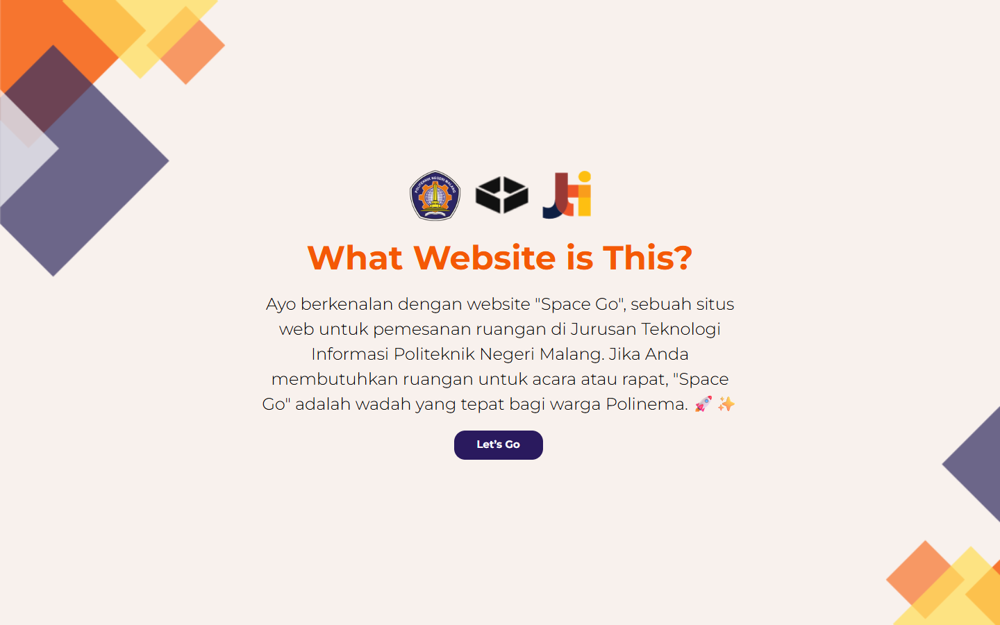

## Tampilan

### Pengguna

| Beranda | Denah dan daftar ruang |
|---|---|
| 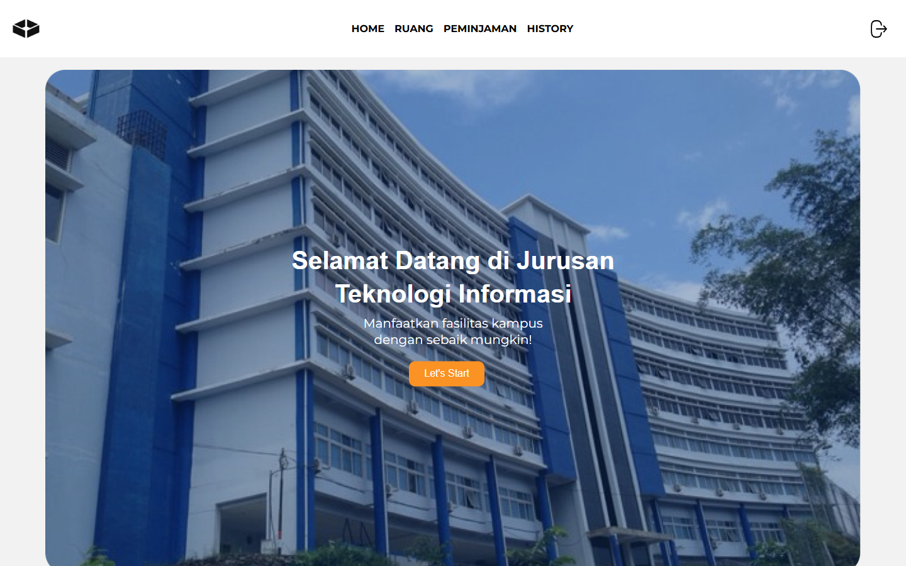 | 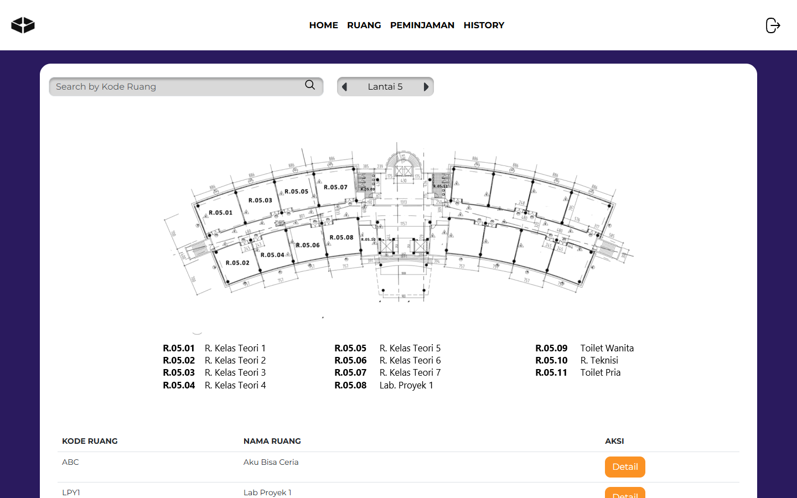 |

| Pengajuan peminjaman | Riwayat dan cetak bukti |
|---|---|
| 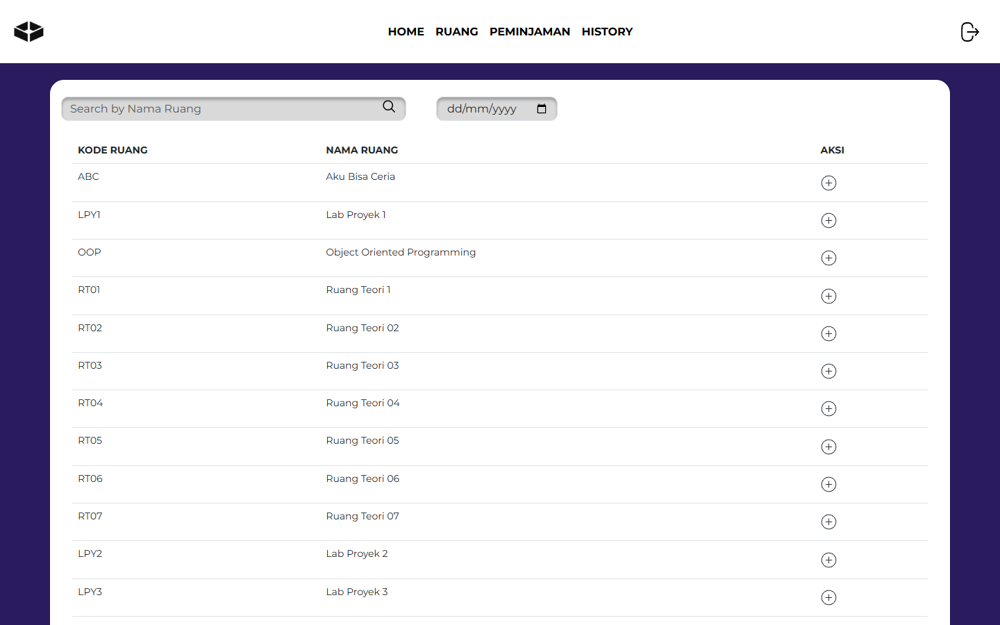 | 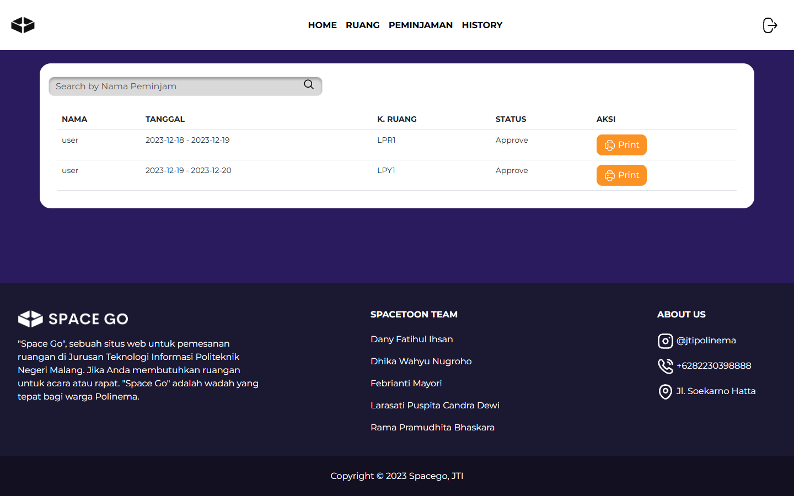 |

### Admin

| Dashboard | Kelola ruang |
|---|---|
| 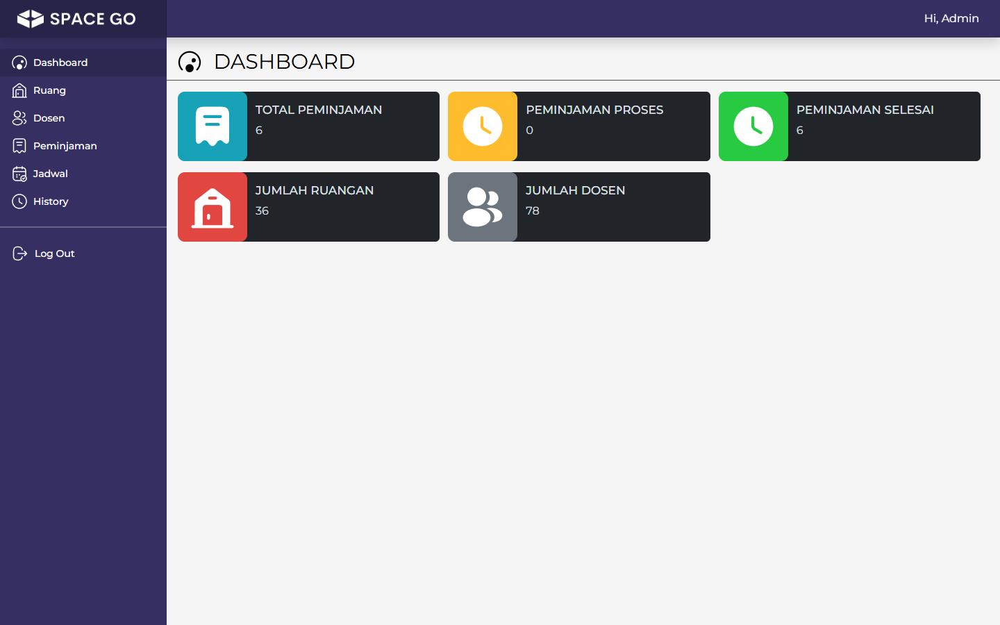 | 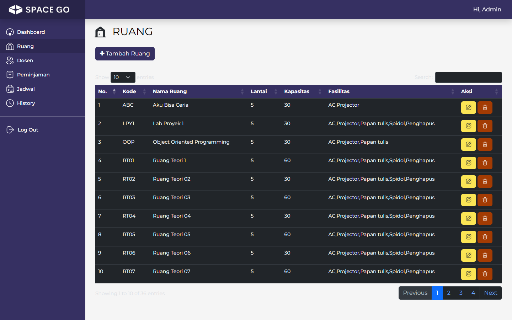 |

| Kelola jadwal | Persetujuan peminjaman |
|---|---|
| 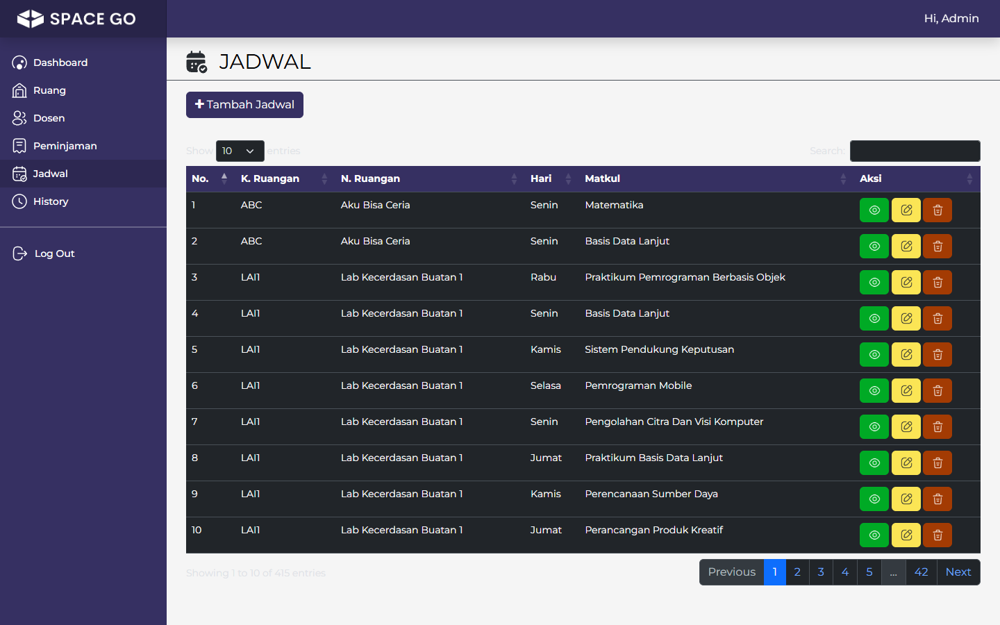 | 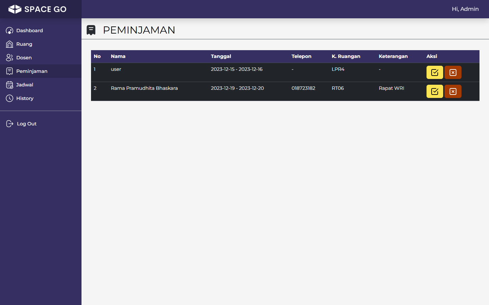 |

### Login

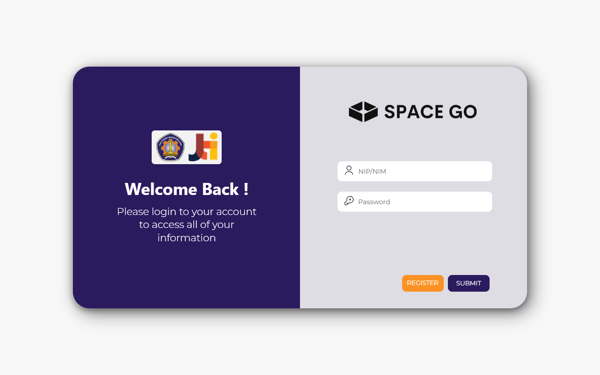

## Fitur

**Pengguna (role `User`)**
- Daftar akun dan login
- Melihat denah per lantai, daftar ruangan beserta fasilitasnya, dan jadwal kuliah di tiap ruangan
- Mengajukan peminjaman ruangan
- Melihat riwayat peminjaman dan mencetak bukti peminjaman

**Admin (role `Admin`)**
- Dashboard berisi ringkasan: total peminjaman, peminjaman yang masih berjalan dan yang sudah selesai, jumlah ruangan, dan jumlah dosen
- Kelola data ruangan dan fasilitasnya
- Kelola data dosen
- Kelola jadwal kuliah
- Menerima (*approve*) atau menolak (*decline*) pengajuan peminjaman
- Melihat riwayat semua peminjaman

Sebagian logika ada di database, bukan di PHP:
- *Stored procedure* `tambahJadwal` dan `editJadwal` untuk menyimpan jadwal, serta `updatePeminjamanStatus` untuk menandai peminjaman yang sudah lewat tanggal kembali sebagai `Selesai`
- *Function* `getJumlahDosen` dan `peminjaman_by_status` untuk angka di dashboard
- *Trigger* yang mencegah ruangan dihapus selama masih ada data peminjamannya, dan yang menolak kapasitas ruangan bernilai negatif

## Struktur Database (ERD)

Diagram di bawah menunjukkan tabel-tabel yang dipakai Space Go dan hubungan antar tabelnya.

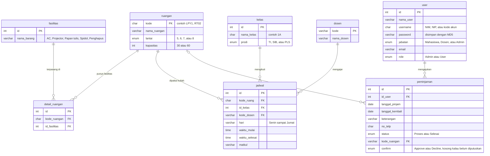

**Penjelasan singkat tiap tabel:**

| Tabel | Fungsinya |
|---|---|
| `user` | Akun untuk login. Kolom `role` menentukan apakah akun masuk ke halaman admin atau halaman pengguna |
| `ruangan` | Daftar ruangan beserta lantai dan kapasitasnya |
| `fasilitas`, `detail_ruangan` | Daftar fasilitas dan tabel penghubungnya. Satu ruangan bisa punya banyak fasilitas, dan satu jenis fasilitas bisa ada di banyak ruangan |
| `dosen`, `kelas` | Data induk dosen dan kelas |
| `jadwal` | Jadwal kuliah. Satu baris berarti satu kelas diajar satu dosen di satu ruangan pada hari dan jam tertentu |
| `peminjaman` | Pengajuan pinjam ruangan oleh pengguna. `status` berubah menjadi `Selesai` otomatis setelah tanggal kembali lewat, sedangkan `confirm` diisi admin dan kosong selama pengajuan belum diputuskan |

Arti garis penghubung: `||` berarti **tepat satu**, `o{` berarti **boleh nol atau banyak**, dan `|o` berarti **boleh kosong atau satu**. Contohnya, satu ruangan bisa punya banyak jadwal, tapi setiap jadwal hanya untuk satu ruangan.

**Cara hubungan antar tabel dijaga:**
- Di dump asli `peminjaman-ruang.sql`, hubungan di atas dijaga oleh *foreign key* dengan `ON DELETE CASCADE` dan `ON UPDATE CASCADE`.
- File `peminjaman-ruang-hosting.sql` tidak memuat *foreign key*. Aplikasi menjaganya sendiri lewat PHP (folder `app/models`): menghapus ruangan ikut menghapus jadwal dan fasilitasnya, menghapus dosen ikut menghapus jadwalnya, dan mengubah kode ruangan atau dosen ikut memperbarui data yang terkait.
- Ruangan yang masih punya data peminjaman tidak bisa dihapus, dan kapasitas ruangan tidak boleh negatif.

## Kebutuhan

- PHP 8.x dengan ekstensi PDO MySQL
- MySQL 8.x atau MariaDB 10.4+
- Apache dengan `mod_rewrite` aktif

Cara paling gampang adalah memakai [Laragon](https://laragon.org/) atau XAMPP, karena semua kebutuhan di atas sudah tersedia di dalamnya.

## Instalasi

1. Clone repo ini ke folder web server kamu (misalnya `www` di Laragon atau `htdocs` di XAMPP).

   ```bash
   git clone https://github.com/Dhiyun/MVC.git
   ```

2. Buat database bernama `peminjaman-ruang`, lalu import file [peminjaman-ruang.sql](peminjaman-ruang.sql). File ini sudah berisi tabel, data contoh, *procedure*, *function*, dan *trigger*.

   ```bash
   mysql -u root -p -e "CREATE DATABASE \`peminjaman-ruang\`"
   mysql -u root -p peminjaman-ruang < peminjaman-ruang.sql
   ```

   Bisa juga lewat phpMyAdmin atau HeidiSQL.

   Procedure, function, dan trigger di file dump memakai `DEFINER=root@localhost`. Kalau kamu mengimpor dengan user selain `root`, hapus dulu bagian `DEFINER=...` di file SQL supaya tidak muncul error hak akses.

3. Salin [app/config/config.example.php](app/config/config.example.php) menjadi `app/config/config.php`, lalu sesuaikan dua hal:

   ```bash
   cp app/config/config.example.php app/config/config.php
   ```

   - **`BASEURL`** harus mengarah ke folder `public` sesuai lokasi project di komputer kamu, dan diakhiri garis miring. Contohnya, kalau project ada di `www/PhpNative/MVC`, isinya `http://localhost/PhpNative/MVC/public/`. URL lain (`ADMINURL`, `USERURL`, dan seterusnya) otomatis mengikuti `BASEURL`.
   - **Database.** Isi `DB_HOST`, `DB_USER`, `DB_PASS`, dan `DB_NAME` sesuai pengaturan MySQL kamu.

   File `config.php` sudah masuk `.gitignore`, jadi pengaturan dan password di komputermu tidak ikut terunggah ke GitHub.

4. Buka `BASEURL` tadi di browser, misalnya `http://localhost/PhpNative/MVC/public/`.

## Akun Bawaan

Data contoh di file SQL sudah menyertakan dua akun yang bisa langsung dipakai:

| Role  | Username | Password |
|-------|----------|----------|
| Admin | `admin`  | `admin`  |
| User  | `user`   | `user`   |

Akun baru yang dibuat lewat halaman Register otomatis mendapat role `User`. Untuk membuat admin lain, ubah kolom `role` di tabel `user` langsung dari database.

## Struktur Folder

```
SpaceGo/
├── app/
│   ├── config/       # config.example.php: contoh konfigurasi URL dan koneksi database
│   ├── controllers/  # Admin, User, Home, Log (login), Reg (register), Ruang, Dosen, Jadwal, Peminjaman
│   ├── core/         # App (router), Controller, Database (wrapper PDO), Flasher (pesan notifikasi)
│   ├── fungsi/       # fungsi bantu, dipakai untuk pesan error di halaman login
│   ├── models/       # query ke database
│   ├── views/        # tampilan, dipisah per role: home, admin, user
│   └── init.php      # memuat semua file inti
├── docs/screenshots/ # gambar untuk README ini
├── public/
│   ├── assets/       # Bootstrap, Font Awesome, gambar denah, CSS dan JS tambahan
│   ├── .htaccess     # mengarahkan semua request ke index.php
│   └── index.php     # pintu masuk aplikasi
├── sql/              # draf procedure, function, dan trigger (tidak perlu diimpor)
└── peminjaman-ruang.sql  # dump database lengkap
```

## Cara Kerja Routing

Semua request masuk ke `public/index.php` lewat aturan di `public/.htaccess`. Dari situ, class `App` memecah URL menjadi tiga bagian:

```
/{controller}/{method}/{parameter}
```

Contohnya, `/ruang/hapus/LPR1` akan memanggil method `hapus('LPR1')` di controller `Ruang`. Kalau controller tidak ditemukan, yang dipakai `Home`. Kalau method tidak ditemukan, yang dipakai `index`. Itu sebabnya `/admin/dashboard` tetap membuka dashboard walaupun controller `Admin` tidak punya method `dashboard`.

Controller `Admin`, `Ruang`, `Dosen`, dan `Jadwal` hanya bisa diakses oleh role `Admin`, sedangkan `User` hanya oleh role `User`. Di controller `Peminjaman`, aksi *approve* dan *decline* khusus admin, sedangkan tambah dan hapus khusus pengguna. Pengguna hanya bisa menghapus peminjaman miliknya sendiri. Siapa pun yang tidak punya akses akan dikembalikan ke halaman awal.

Nama controller di URL harus sama persis dengan nama filenya, termasuk huruf besar-kecil, kalau server berjalan di Linux. Di Windows hal ini tidak berpengaruh.

Halaman-halaman utama:

| URL | Halaman |
|-----|---------|
| `/` | Halaman perkenalan |
| `/log` | Login |
| `/reg` | Register |
| `/admin/dashboard` | Dashboard admin |
| `/admin/ruang`, `/admin/dosen`, `/admin/jadwal` | Kelola data master |
| `/admin/peminjaman` | Persetujuan peminjaman |
| `/admin/history` | Riwayat semua peminjaman |
| `/user/dashboard` | Beranda pengguna |
| `/user/ruang` | Denah, ruangan, dan jadwal |
| `/user/peminjaman` | Form pengajuan peminjaman |
| `/user/history` | Riwayat dan cetak bukti peminjaman |

## Catatan

- Dump database dibuat di MariaDB 10.4. Kalau kamu pakai MySQL, mode `ONLY_FULL_GROUP_BY` sudah dimatikan per koneksi di [app/core/Database.php](app/core/Database.php) supaya query `GROUP BY` di halaman ruangan tetap jalan.
- Halaman admin dan user memuat CSS dengan path relatif (`../assets/...`). Karena itu, buka halaman lewat URL dua tingkat seperti `/admin/dashboard` atau `/user/dashboard`, bukan `/admin` saja, supaya tampilannya tidak berantakan. Menu navigasi di aplikasi sudah memakai URL yang benar.
- Password disimpan dengan MD5. Ini cukup untuk keperluan belajar, tapi jangan dipakai di lingkungan produksi. Gunakan `password_hash()` dan `password_verify()` kalau project ini mau dikembangkan lebih jauh.
- Semua procedure, function, dan trigger sudah ada di `peminjaman-ruang.sql`. File di folder `sql/` hanya draf lama dan sebagian berisi kesalahan sintaks, jadi tidak perlu dijalankan.
- Folder `public/assets` berisi source lengkap Bootstrap, termasuk `README.md`, `LICENSE`, dan file lain milik Bootstrap. File-file itu bukan bagian dari dokumentasi aplikasi ini.

## Tim

Dibuat oleh Spacetoon Team:

- Dany Fatihul Ihsan
- Dhika Wahyu Nugroho
- Febrianti Mayori
- Larasati Puspita Candra Dewi
- Rama Pramudhita Bhaskara
